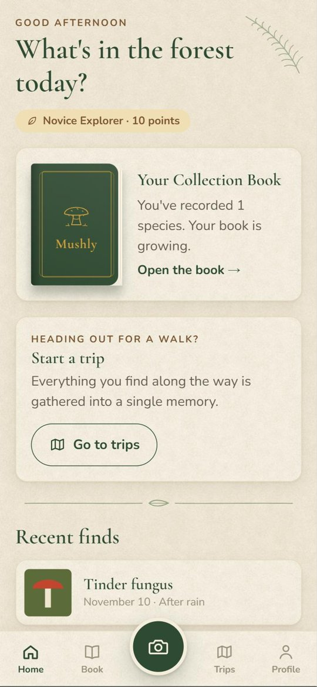
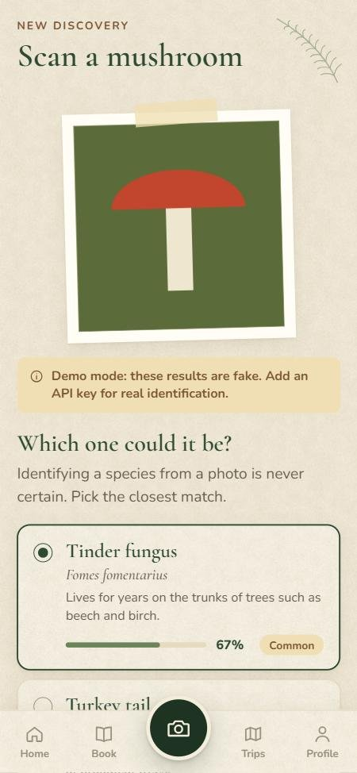
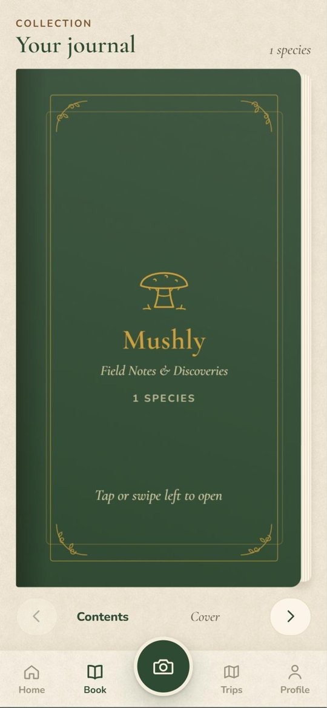
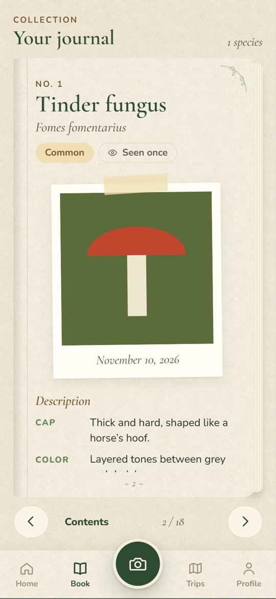

<div align="center">

# 🍄 Mushly

**A field journal that turns forest walks into a collection of mushroom discoveries.**

Photograph a mushroom, get the three most likely species, and watch a hand-drawn notebook fill up page by page.

[](https://docs.expo.dev)
[](https://reactnative.dev)


[Türkçe](README.tr.md) · [Roadmap](docs/ROADMAP.md)

</div>

<p align="center">
  
  
  
  
</p>

> [!IMPORTANT]
> Mushly is a nature journal, **not a consumption guide**. It never shows edibility or toxicity information, and identifying a species from a photo is never certain.

## Features

- **Photo identification** — take or choose a photo; an AI vision model suggests the 3 most likely species with confidence scores.
- **A collection book** — every new species gets its own page in a notebook you flip with your finger, with a description, a "Did you know?" fact and your photos.
- **Field notes** — date, place (optional GPS), weather, who you were with and a free-form note for each find.
- **Drafts** — not sure? Save the find as a draft and pick the species later.
- **Works offline** — photos taken without a connection wait in a queue and are identified automatically once you're back online.
- **"?" pages** — faded pages with hints for species you haven't found yet.
- **Points, levels and badges** — the groundwork is in place; the rules arrive in stage 4.
- **Bilingual** — the interface and the AI-written descriptions follow the phone's language (English or Turkish).

## Safety by design

The project has one non-negotiable rule: **no edibility, toxicity or consumption information, anywhere.**

- The recognition schema has no field for it, and the prompt forbids it.
- Every response passes through an allow-list filter ([`src/services/safety.js`](src/services/safety.js)) that drops unknown fields and any sentence containing a banned word stem, in both languages.
- The filter runs twice: on the server and again on the phone.

## Tech stack

| Area | Choice |
|---|---|
| Framework | React Native + [Expo](https://expo.dev) SDK 58, JavaScript |
| Navigation | Expo Router (file-based, `src/app/`) |
| Local data | SQLite (`expo-sqlite`), photos stored as files |
| Animation & gestures | Reanimated 4 + Gesture Handler (page flip runs on the UI thread) |
| Graphics | `react-native-svg` for icons, ornaments and paper texture |
| Fonts | Cormorant Garamond (headings), Nunito (body) |
| Localization | `expo-localization` + a small dictionary-based `t()` helper |
| Recognition | Expo API route → Evren LLM API, with Google Gemini and Anthropic Claude as automatic fallbacks |

## Getting started

**Requirements:** [Node.js](https://nodejs.org) 22.13 or newer, and the **Expo Go** app on your phone ([iOS](https://apps.apple.com/app/expo-go/id982107779) / [Android](https://play.google.com/store/apps/details?id=host.exp.exponent)).

```bash
git clone https://github.com/rumeysabasaran/mushly.git
cd mushly
npm install
npm start
```

Scan the QR code in the terminal (Android: from Expo Go; iPhone: with the Camera app). Your phone and computer need to be on the same Wi-Fi; if that's not possible, use `npx expo start --tunnel`.

| Command | What it does |
|---|---|
| `npm start` | Starts the dev server for Expo Go |
| `npm run web` | Quick preview in the browser at `http://localhost:8081` (no camera or haptics) |
| `npm run doctor` | Checks the project for common Expo issues |

Without an API key the app runs in **demo mode** and returns the same three sample species, so you can try the whole flow right away.

To preview a specific language, set `EXPO_PUBLIC_LANGUAGE=en` or `EXPO_PUBLIC_LANGUAGE=tr` before starting the dev server.

## Configuration

Copy `.env.example` to `.env` and add at least one key. The `.env` file is git-ignored; keys are only read by the server code and never reach the phone.

| Variable | Purpose |
|---|---|
| `EVREN_API_KEY` | Default recognition service ([Evren LLM API](https://evren-llmapi.ssyz.org.tr), free until 1 Dec 2026) |
| `EVREN_MODEL` | Optional, defaults to `gemma-4-31b` |
| `GEMINI_API_KEY` | Free fallback ([Google AI Studio](https://aistudio.google.com/apikey)) |
| `GEMINI_MODEL` | Optional, defaults to `gemini-3.5-flash-lite` |
| `ANTHROPIC_API_KEY` | Paid, last-resort fallback (Claude) |
| `RECOGNIZER_ORDER` | Optional order, e.g. `gemini,evren` |

Services with a key are tried in order; if one fails (quota, credit, timeout…), the next takes over. Restart `npm start` after changing `.env`; the terminal prints the active chain, e.g. `🍄 Species recognition: Evren · gemma-4-31b → fallback: Gemini · gemini-3.5-flash-lite`.

> [!NOTE]
> On Google's free tier, submitted content may be used to improve Google's products. Only the photo is sent; location and field notes never leave the phone.

## Project structure

```
src/
  app/                    Screens (Expo Router: file name = route)
    (tabs)/               Home, Book, Scan, Trips, Profile
    pending.jsx           Photos waiting to be identified
    api/identify+api.js   Recognition endpoint (runs on the dev server)
  components/             book/, scan/, layout/, ui/
  data/                   SQLite database, live-query hooks, catalog, gamification
  services/               Photos, recognizer client, offline queue, safety filter
  i18n/                   en.js, tr.js and the t() helper
  theme.js                Colors, fonts, sizes and shadows
server/                   Prompt, fallback chain and service providers
functions/                Production endpoint (Cloudflare Pages Functions)
locales/                  Localized app name and permission texts
docs/                     Roadmap and screenshots
```

## Roadmap

Mushly is built in stages; see [docs/ROADMAP.md](docs/ROADMAP.md) for details and design decisions.

- [x] Project structure, theme and core screens
- [x] Photo capture and species recognition
- [x] Collection book with page flipping
- [x] Native app with React Native (Expo)
- [x] English and Turkish
- [ ] Points, badges and levels
- [ ] Trips and profile
- [ ] App icon, splash screen, hosted recognition server and installable builds

The earlier web (PWA) version is preserved on the [`web-son`](https://github.com/rumeysabasaran/mushly/tree/web-son) branch.
