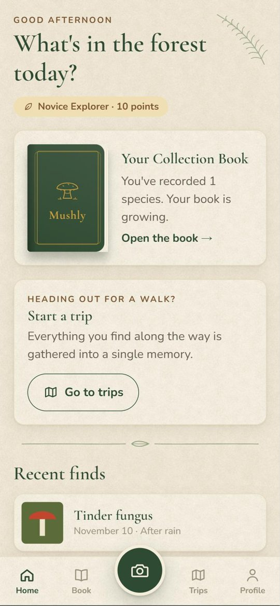
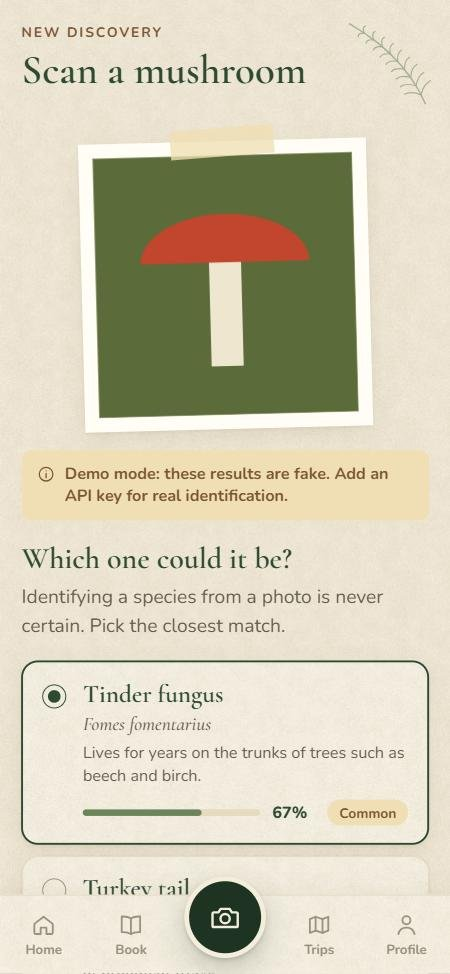
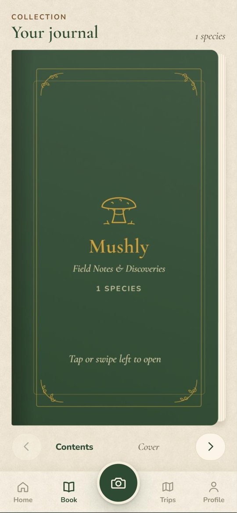

<div align="center">

# 🍄 Mushly

**Orman yürüyüşlerini bir mantar keşif koleksiyonuna dönüştüren saha defteri.**

[English](README.md) · [Yol haritası (İngilizce)](docs/ROADMAP.md)

</div>

<p align="center">
  
  
  
</p>

> [!IMPORTANT]
> Mushly bir keşif defteridir, **tüketim rehberi değildir**. Hiçbir yerde yenebilirlik ya da zehirlilik bilgisi göstermez; fotoğrafla tür tespiti kesin değildir.

Uygulama telefonun diline göre **Türkçe** ya da **İngilizce** açılır. Yapay zekânın yazdığı tür tanımları da aynı dilde gelir.

## Telefonda çalıştırma (Expo Go)

**Bir kez yapılır:**
1. Bilgisayarda [Node.js](https://nodejs.org) **22.13 veya üstü** kurulu olmalı (`node --version` ile bakabilirsin).
2. Telefonuna mağazadan **Expo Go** uygulamasını kur.
3. Proje klasöründe paketleri indir (paket listesi değişince de tekrarlanır):
   ```bash
   npm install
   ```

**Her seferinde:**
1. Telefon ve bilgisayar **aynı Wi-Fi**'de olmalı.
2. Uygulamayı başlat:
   ```bash
   npm start
   ```
3. Terminaldeki **QR kodu** okut (Android: Expo Go içinden, iPhone: kamerayla).
4. Kodu kaydettiğinde telefondaki uygulama kendiliğinden yenilenir. Durdurmak için `Ctrl + C`.

Aynı Wi-Fi'de bağlanamazsan: `npx expo start --tunnel`. Tarayıcıda hızlıca bakmak için: `npm run web`.

Belirli bir dili denemek için sunucuyu `EXPO_PUBLIC_LANGUAGE=en` ya da `EXPO_PUBLIC_LANGUAGE=tr` ile başlatabilirsin.

## Tür tanıma ve API anahtarı

Anahtar yoksa uygulama **deneme modunda** çalışır (her fotoğrafa aynı üç türden sahte sonuç).

1. `.env.example` dosyasının bir kopyasını oluştur, adını `.env` yap.
2. Anahtarlarını yapıştır:
   - `EVREN_API_KEY` — varsayılan servis (Evren LLM API, 1 Aralık 2026'ya kadar ücretsiz)
   - `GEMINI_API_KEY` — ücretsiz yedek ([Google AI Studio](https://aistudio.google.com/apikey))
   - `ANTHROPIC_API_KEY` — ücretli son yedek (Claude, isteğe bağlı)
3. `npm start`'ı durdurup yeniden başlat. Terminalde etkin zinciri görürsün:
   `🍄 Species recognition: Evren · gemma-4-31b → fallback: Gemini · gemini-3.5-flash-lite`

Bir servis hata verirse (kota, kredi, zaman aşımı…) sıradaki otomatik devralır. Sırayı değiştirmek için: `RECOGNIZER_ORDER=gemini,evren`.

**Anahtar neden güvende?** `.env` GitHub'a gönderilmez. Anahtar sadece bilgisayardaki sunucu kodunda (`server/`, `src/app/api/`) okunur; telefona hiç inmez.

## Klasörler

| Klasör | İçerik |
|---|---|
| `src/app/` | Ekranlar: Ana Sayfa, Kitap, Tara, Geziler, Profil, Bekleyenler |
| `src/components/` | Kitap, tarama akışı, alt menü ve arayüz parçaları |
| `src/i18n/` | Türkçe (`tr.js`) ve İngilizce (`en.js`) metinler |
| `src/data/` | Telefondaki veritabanı (SQLite) ve oyun kuralları |
| `src/services/` | Fotoğraflar, tanıma, **güvenlik süzgeci**, bekleyenler kuyruğu |
| `src/theme.js` | Tüm renkler, yazı tipleri ve ölçüler |
| `server/` | Tanıma servislerine bağlanan kod (Evren → Gemini → Claude) |

Eski web sürümü `web-son` dalında duruyor: `git checkout web-son` (geri dönmek için `git checkout main`).
